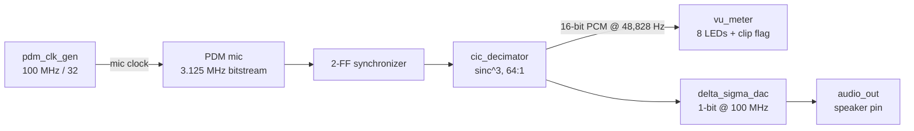

# PDM Microphone to Speaker: CIC Filter and Delta-Sigma DAC on an FPGA


A standalone audio pipeline in Verilog for the Real Digital Blackboard (Zynq-7000, XC7Z007S). The board's PDM microphone gives a raw 1-bit stream. A CIC decimation filter I wrote turns it into 16-bit audio samples, those samples drive an LED volume meter, and a delta-sigma modulator I also wrote turns them back into a 1-bit stream for the board's speaker pin. There is no UART, no host link and no PC software. Program the board and it runs.

This is the fourth project on this board, after a [UART to VGA terminal](https://github.com/HThakkar23/uart-vga-terminal), a [logic analyzer](https://github.com/HThakkar23/logic-analyzer) and a [UART to AXI4-Lite bridge](https://github.com/HThakkar23/axi-lite-bridge). Those three were about getting a host link protocol exactly right. This one drops the host link and spends the effort on signal processing, because the Blackboard has no audio codec chip on the pins this uses. It has a bare PDM microphone and a single raw speaker pin, so getting from one to real audio samples and back is itself the design problem.

Every number below comes from a Python script in `scripts/` or from a simulation I ran. The step response numbers come from a cycle-accurate Python copy of the RTL, not from hand tracing.

<!-- Add a photo of the board or a short clip of the LED meter reacting to sound, for example:  -->

## Quick Start

**Needs:** Vivado (2019.2 or newer) and a Real Digital Blackboard. Nothing else.

```
git clone https://github.com/HThakkar23/pdm-audio-dsp
```

In the Vivado Tcl console:

```
cd pdm-audio-dsp
source scripts/create_project.tcl
```

Run synthesis, implementation and bitstream generation, then program the board. Talk near the microphone or tap the case and the LED bar on `led[9:2]` follows the loudness. `led[1]` lights when the signal gets close to clipping, and the speaker pin carries the re-modulated audio.

The microphone and speaker pins in `constr/blackboard_pdm.xdc` were read without an IOSTANDARD attached, so check that one against your board's master XDC before building. Full steps are in [SETUP.md](SETUP.md).

## What a PDM microphone actually gives you

The output of a PDM microphone is not audio samples. It is one wire toggling at a few megahertz, and the density of 1s over time encodes the waveform: lots of 1s means the sound pressure is high, lots of 0s means it is low. To get usable audio out of that you need a decimation filter that averages many bits into one multi-bit sample.

The standard answer is a CIC (cascaded integrator-comb) filter. Integrators run at the fast bit rate and combs run at the slow output rate, and when the input is already 1 bit, every stage is a plain adder or subtractor. There is no multiplier anywhere in `cic_decimator.v`.

## How the design fits together



It is a single clock domain. The mic clock divider, the decimator and the modulator all run from the 100 MHz board oscillator, so there is no clock wizard and no clock domain crossing, apart from the 2-FF synchronizer the mic's asynchronous data pin needs.

### Sizing the CIC filter

A CIC filter of order N with decimation ratio R needs `ceil(N * log2(R))` extra bits to hold its internal sums without losing information (Hogenauer, 1981). Here N is 3 and R is 64, so the growth is `3 * 6 = 18` bits. The input is 1 bit (plus or minus 1), so the accumulators are 19 bits wide. `scripts/cic_filter_calc.py` derives that and checks it against the parameter in `cic_decimator.v`.

Nothing in the design saturates. Every integrator and comb is left to wrap in 2's complement, which is exactly what makes a CIC filter work: as long as every stage is wide enough, the wraparounds cancel out in the final comb. The decimated output is the top 16 bits of that 19 bit result.

### Going back out: the delta-sigma DAC

The speaker pin has no DAC chip behind it, just a digital output meant for PWM or PDM drive. A 1st-order error-feedback delta-sigma modulator turns each 16-bit sample into a 1-bit stream whose running average follows the sample. The oversampling pushes the quantization noise up and out of the audio band, which is the same noise-shaping idea real audio DACs use. Mine is one adder, one comparator and one feedback register (`delta_sigma_dac.v`).

## The numbers

**CIC decimator** (`cic_filter_calc.py`):

```
ACC_WIDTH (Hogenauer)     : 19 bits   (ceil(3 * log2(64)) + 1 sign bit)
PDM bit clock             : 3,125,000 Hz
Decimated PCM sample rate : 48,828.125 Hz
Output Nyquist            : 24,414.0625 Hz
```

Step response, measured by driving a cycle-accurate Python copy of the RTL (same register widths, same nonblocking update order) with a step from 12.5% to 87.5% duty:

```
first decimated sample to change : 304 PDM bit periods =  9,728 clocks =  97.28 us
fully settled                    : 496 PDM bit periods = 15,872 clocks = 158.72 us
```

The textbook group delay estimate for this filter, `N*(R-1)/2 = 94.5` PDM periods, is smaller, because group delay is an average delay and not the time to fully settle.

Passband droop of the sinc^3 response, relative to DC:

```
   300 Hz (telephone band low edge)  :  -0.002 dB
 3,400 Hz (telephone band high edge) :  -0.208 dB
 8,000 Hz (wideband speech edge)     :  -1.161 dB
        output Nyquist               : -11.765 dB
```

That is flat to within a fifth of a dB across the telephone voice band. Past 8 kHz the droop gets noticeable, which is why I sized this for speech and not for full 20 kHz audio.

**Delta-sigma DAC** (`delta_sigma_calc.py`):

```
Oversampling ratio (OSR)       : 2048   (100 MHz / 48,828.125 Hz, exact)
Theoretical in-band SNR        : 101.95 dB
Effective resolution           : 16.64 bits
```

The SNR is calculated from the standard noise-shaping formula for a 1st-order, 1-bit loop. It is a theoretical figure, not a measurement of the speaker output. Here is how order and OSR trade off:

```
  order | OSR=64    | OSR=256   | OSR=1024  | OSR=2048
      1 |  56.79 dB |  74.86 dB |  92.92 dB | 101.95 dB  <- this design
      2 |  85.19 dB | 115.30 dB | 145.40 dB | 160.45 dB
      3 | 112.83 dB | 154.98 dB | 197.12 dB | 218.20 dB
```

A 2nd-order loop at the same OSR would buy about 58 dB more. I stayed with 1st order because it needs no stability analysis, which is a deliberate trade for simplicity, not an oversight.

**VU meter.** `DECAY_SHIFT = 6` gives an envelope time constant of 64 decimated samples, 1.31 ms at the output rate. That is fast enough to feel responsive and slow enough not to flicker on individual samples.

## A design detail worth knowing about

Because the decimator never saturates, there is exactly one input where the wraparound assumption fails: a sustained all-1s or all-0s bitstream. Its ideal output is plus or minus 32,768, and +32,768 does not fit in a signed 16-bit number (range -32,768 to +32,767). The calc script runs it instead of leaving it as a hand-wave. All-0s settles at exactly -32,768 as expected, and a sustained all-1s input, chasing +32,768, wraps around to -32,768 as well.

Real microphone audio is AC-coupled and never sits on a DC rail, so this does not happen in normal use. It is also the one input the testbench deliberately does not drive, and now the script backs that up with an actual run.

## Simulation

I ran both testbenches with Icarus Verilog 12 and both report `ALL CHECKS PASSED`:

| Testbench | Check | Result |
| --- | --- | --- |
| `tb_cic_decimator` | 50% duty input | settles to 0 |
| | 87.5% duty input | settles at 24,576 |
| | 12.5% duty input | settles at -24,576 |
| `tb_delta_sigma_dac` | zero input | 50.00% output duty |
| | +half scale | 75.00% output duty |
| | -half scale | 25.00% output duty |

The CIC numbers match the hand calculation in the testbench header. A DC input `x` of 0.75 should settle at `0.75 * 262,144 / 8 = 24,576`, which is exactly what comes out.

```
iverilog -g2012 -o sim_cic.out rtl/cic_decimator.v sim/tb_cic_decimator.v && vvp sim_cic.out
iverilog -g2012 -o sim_dac.out rtl/delta_sigma_dac.v sim/tb_delta_sigma_dac.v && vvp sim_dac.out
```

The CIC testbench drives its inputs on the falling clock edge. My first version drove them on the rising edge with blocking assignments, which races the design under test and made the decimator look dead in some simulators. The mic clock generator, the VU meter and the top level do not have a testbench.

## Repository structure

```
pdm-audio-dsp/
├── constr/
│   └── blackboard_pdm.xdc       # mic and speaker pins, check IOSTANDARD
├── rtl/
│   ├── pdm_audio_top.v          # top level
│   ├── pdm_clk_gen.v            # 100 MHz down to the 3.125 MHz mic clock
│   ├── cic_decimator.v          # sinc^3, 64:1, PDM to 16-bit PCM
│   ├── vu_meter.v               # peak with decay, 8 LEDs + clip flag
│   ├── delta_sigma_dac.v        # 1st-order, PCM to 1-bit speaker drive
│   └── reset_sync.v
├── scripts/
│   ├── create_project.tcl
│   ├── cic_filter_calc.py       # register growth, latency, droop, edge case
│   └── delta_sigma_calc.py      # OSR, SNR, order comparison, VU decay
├── sim/
│   ├── tb_cic_decimator.v
│   └── tb_delta_sigma_dac.v
└── SETUP.md
```

There is no `host/` folder in this project, since there is nothing for a PC to talk to.

## Areas for improvement

- **A 2nd-order delta-sigma loop.** It is where the extra 58 dB is, at the cost of a real stability analysis.
- **A droop equalizer.** A small FIR after the CIC to flatten the sinc^3 droop before it becomes audible at wider bandwidths than the telephone band.
- **Get the audio to a PC.** Route the PCM out over the AXI4-Lite bridge's register file to capture real waveforms on a host, and measure the actual speaker output SNR instead of quoting the theoretical one.
- **A testbench for the top level.** Feed a synthetic PDM tone in and check the meter and the DAC output together.

## References and resources

- E. B. Hogenauer, "An Economical Class of Digital Filters for Decimation and Interpolation," IEEE Transactions on Acoustics, Speech, and Signal Processing, 1981. The register growth bound used above.
- R. Schreier and G. Temes, "Understanding Delta-Sigma Data Converters," for the noise-shaping SNR formula.
- The datasheet for the board's PDM microphone (SPK0833LM4H) for its clock range and output format.
- Real Digital Blackboard: https://www.realdigital.org/hardware/blackboard
- My earlier projects on this board: https://github.com/HThakkar23/uart-vga-terminal, https://github.com/HThakkar23/logic-analyzer and https://github.com/HThakkar23/axi-lite-bridge
